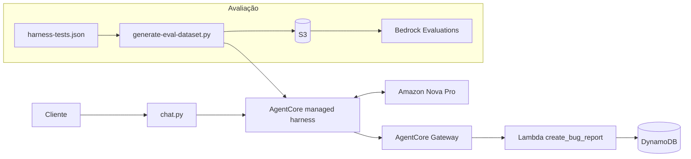

# Chatbot de suporte com Amazon Bedrock AgentCore

Chatbot de atendimento para uma loja online fictícia, em que **toda a lógica de roteamento fica em um único system prompt**. O AgentCore managed harness cuida do loop do agente, das sessões e da execução de ferramentas. O prompt define o comportamento.

O desempenho foi medido com Amazon Bedrock Evaluations (LLM como juiz), e a pontuação subiu de **0,55 para 0,842** ao longo das iterações.

## Contexto

Projeto do curso *Prompting and LLM Reasoning*, da formação de engenharia de agentes de IA na AWS da Udacity. O código de infraestrutura e os scripts de apoio partem do [material inicial do curso](https://github.com/udacity/aws-c1-prompting-llm-reasoning-nd905-cd14762-project). Meu trabalho está no system prompt, na suíte de testes, na avaliação e nas iterações.

O desafio é usar engenharia de prompt no lugar de nós de decisão ou classificadores separados. O bot classifica cada mensagem em uma de três rotas:

| Rota | Comportamento |
| --- | --- |
| **Bug reports** | Coleta descrição, passos para reproduzir e ambiente ao longo da conversa. Depois registra o ticket pela ferramenta `create_bug_report` e devolve o ID. |
| **Dúvidas sobre a plataforma** | Responde sobre pedidos, entrega, devoluções e pagamentos usando somente o FAQ embutido no prompt. |
| **Outros pedidos** | Encaminha com educação para o telefone do suporte humano. Isso inclui nomes soltos e saudações. |

## Arquitetura



- **AgentCore managed harness:** executa o agente, mantém o estado da sessão e chama as ferramentas.
- **System prompt:** define as rotas e as regras de coleta. O `create_harness.py` substitui o marcador `{{FAQ}}` pelo conteúdo de `online_shop_faq.md`.
- **AgentCore Gateway:** expõe a Lambda ao modelo como a ferramenta `create_bug_report`.
- **Lambda + DynamoDB:** grava cada bug report completo como um ticket.
- **Bedrock Evaluations:** pontua as respostas com a métrica `Builtin.Correctness`, usando `amazon.nova-pro-v1:0` como juiz.
- **CloudFormation:** cria tabela, Lambda, papéis IAM, bucket de avaliação e papel de avaliação.

## Resultados

| Métrica | Valor |
| --- | --- |
| Casos de teste | 19 |
| **Pontuação média final** | **0,842** |
| Aprovados (nota ≥ 0,5) | 16 de 19 |
| Reprovados | 3 de 19 |

A suíte cobre as três rotas e casos de borda, como tentativa de prompt injection, mensagens ambíguas entre dúvida e bug, nome solto, saudação e conversa fora do tema.

### O que melhorou a pontuação

1. **Referências dos testes:** alguns casos esperavam memória de vários turnos, mas cada teste roda em uma sessão nova, com um único turno. Reescrevi esses casos para descrever o comportamento correto em um turno e adicionei testes autossuficientes de chamada de ferramenta.
2. **System prompt:** a avaliação mostrou que o modelo registrava bugs sem ter os três campos e às vezes tratava dúvidas de pedido ou pagamento como bug. O prompt passou a proibir que o modelo presuma campos ausentes ou afirme ter aberto um ticket antes de chamar a ferramenta. Também passou a tratar pedidos, pagamentos, reembolsos e cancelamentos como dúvidas, a menos que o cliente fale em bug.

### Falhas restantes

| Caso | Motivo |
| --- | --- |
| `bug-complete-001` | A mensagem traz os três campos, mas o bot confirma o ambiente antes de registrar. É um comportamento cauteloso diante de uma referência rígida. |
| `context-memory-001` | Pergunta sobre um bug anterior em uma sessão nova. É uma limitação de avaliar memória com um único turno. |
| `platform-payment-loss-001` | Mensagem realmente ambígua entre dúvida e bug. Ajustar só esse caso poderia piorar outros mais claros. |

## Estrutura

```text
├── system_prompt.txt              prompt com as rotas e as regras
├── online_shop_faq.md             FAQ embutido no prompt
├── create_harness.py              cria ou atualiza o harness
├── setup_gateway.py               cria o gateway e registra a ferramenta
├── create_bug_report.py           código da Lambda
├── chat.py                        cliente de chat no terminal
├── harness-tests.json             suíte com 19 casos
├── generate-eval-dataset.py       gera o dataset de avaliação
├── show_results.py                resume os resultados baixados
├── eval-config.json               configuração do job de avaliação
├── cloudformation-*.yaml          infraestrutura
├── cleanup_agentcore.py           remove os recursos do AgentCore
└── evidence/                      transcrição, scan do DynamoDB e resultados
```

## Como executar

Pré-requisitos: conta AWS com acesso ao Bedrock, ao AgentCore e ao Amazon Nova Pro, AWS CLI configurada e Python 3.9+ com `boto3` 1.43+. Use a região `us-east-1`.

```bash
pip install -r requirements.txt

aws cloudformation deploy \
  --template-file cloudformation-tool.yaml \
  --stack-name bug-report-tool-stack \
  --capabilities CAPABILITY_NAMED_IAM \
  --region us-east-1

python setup_gateway.py     # gera agentcore_config.json, que fica fora do Git
python create_harness.py    # repita sempre que mudar o prompt
python chat.py              # cada execução abre uma conversa nova
```

Para avaliar:

```bash
python generate-eval-dataset.py --tests-json harness-tests.json

aws cloudformation deploy \
  --template-file cloudformation-testing.yaml \
  --stack-name bug-report-testing-stack \
  --capabilities CAPABILITY_NAMED_IAM \
  --region us-east-1
```

Antes de criar o job, troque `<YOUR_ACCOUNT_ID>` em `eval-config.json` e `output-config.json`, e envie `output_eval_dataset.jsonl` para o bucket. O `show_results.py` lê os resultados baixados em `eval-results/`.

## Limpeza

Esvazie o bucket antes de apagar a stack de testes. Caso contrário, a exclusão termina em `DELETE_FAILED`.

```bash
python cleanup_agentcore.py
aws cloudformation delete-stack --stack-name bug-report-tool-stack --region us-east-1
aws s3 rm s3://udacity-agentic-engineer-c1-eval-<YOUR_ACCOUNT_ID> --recursive
aws cloudformation delete-stack --stack-name bug-report-testing-stack --region us-east-1
```

## Licença

Projeto educacional baseado em material da Udacity, sujeito aos termos de [LICENSE.md](LICENSE.md).
